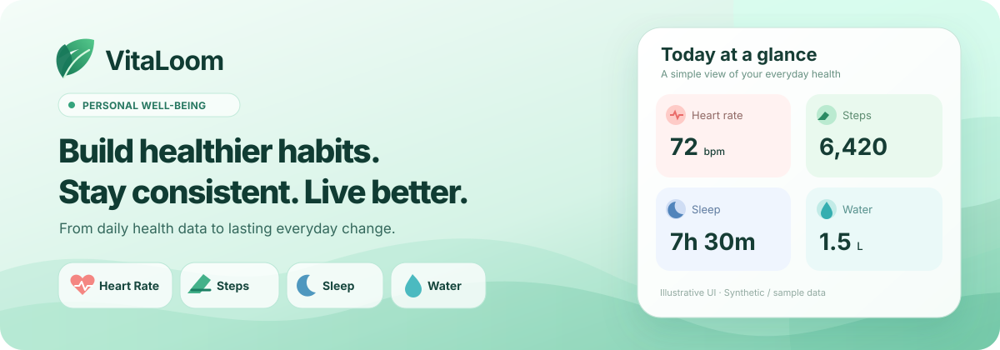
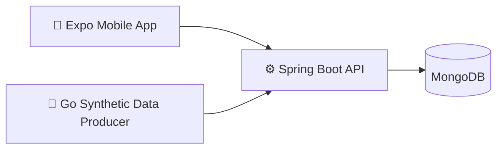

### Personal Health & Behavior Management

**Small, sustainable actions matter more than occasional perfect days.**

VitaLoom is an evolving personal health and behavior management project. We are starting with approachable health tracking and clear reporting, with a long-term vision of helping people build, understand, and maintain healthier routines.

[Explore our mobile app](https://github.com/vitaloom/vitaloom-frontend) · [See the designs](https://github.com/vitaloom/vitaloom-design) · [Browse our repositories](https://github.com/orgs/vitaloom/repositories)

---

## 🌱 Why we're building VitaLoom

Health data becomes more valuable when it helps people understand their everyday patterns and make choices they can sustain.

Our product north star is **consistency over intensity**: helping people show up for their well-being over time, without treating a missed day as failure. We believe people should own their goals, have room to recover, and receive explanations grounded in data rather than unsupported claims.

**Our direction:** `Health Tracking → Understanding → Behavior Management → Long-term Consistency`

## 📊 Our current focus: tracking, dashboards & reports

The present MVP is focused on reliable end-to-end health data flows, history, and accessible summaries across four core metrics.

| Metric | MVP data source | Intended experience |
| :--- | :--- | :--- |
| ❤️ **Heart Rate** | Synthetic readings from the Go Data Producer | Latest recorded reading and daily average; **no heart-rate goal** |
| 👟 **Steps** | Synthetic step events from the Go Data Producer | Daily activity, optional daily step goal and metric-specific weekly insights |
| 🌙 **Sleep** | Manual entries | Sleep journal, optional sleep goal and weekly reporting |
| 💧 **Water Intake** | Manual entries | Intake journal, optional hydration goal, daily progress and weekly reporting |

Each metric owns its own rules, calculations, and goal behavior. Goals are **not** required for every metric, and VitaLoom does not currently provide a universal goal-management feature.

> **Scope is not release status.** The table describes the targeted MVP experience, not a claim that every screen and workflow is already shipped. The standalone Data Producer generates **simulated** events for development and testing; VitaLoom does not currently collect readings from real wearables.

## 🔭 The longer-term vision

Our roadmap is intentionally incremental. Future directions may include:

- **Stronger data foundations:** more reliable history, source transparency, and useful longitudinal reports.
- **Habits & routines:** user-created habits, optionally connected to relevant goals, with flexible handling of missed days.
- **Consistency & contextual insights:** understanding patterns across time without reducing progress to a streak or a single score.
- **Thoughtful support:** user-controlled reminders and explainable, evidence-aware guidance.
- **Connected experiences:** wearable integrations and personal health experiments where a clear user need justifies them.

These are **product directions, not shipped features or delivery commitments**. Current MVP scope excludes habit management, shared reminders, universal goal management, streak scoring, personalized recommendations, advanced cross-metric insights, and real wearable integrations.

## 🧩 Our open-source-facing ecosystem

| Repository | Responsibility |
| :--- | :--- |
| 📱 [**vitaloom-frontend**](https://github.com/vitaloom/vitaloom-frontend) | Expo, React Native, and TypeScript mobile application |
| ⚙️ [**vitaloom-backend**](https://github.com/vitaloom/vitaloom-backend) | Java / Spring Boot APIs, authentication, metrics, statistics, and MongoDB persistence |
| 📡 [**vitaloom-data-producer**](https://github.com/vitaloom/vitaloom-data-producer) | Go CLI for generating and publishing synthetic Heart Rate and Steps events |
| 🎨 [**vitaloom-design**](https://github.com/vitaloom/vitaloom-design) | UI/UX references, shared visual patterns, screen behavior, and design assets |
| 🧪 [**vitaloom-demo**](https://github.com/vitaloom/vitaloom-demo) | Original local end-to-end proof of concept, retained as a reference rather than the active implementation |

### How the pieces fit

The diagram is conceptual. Test/demo environments may place **Nginx** in front of the API. The Backend owns validation, storage, and aggregation; the Producer never writes directly to MongoDB.

For local setup and implementation contracts, follow each repository's own README. The [Backend API contract](https://github.com/vitaloom/vitaloom-backend/blob/main/docs/api/api-contract.md) is the reference for integration behavior.

## 🚧 Where things stand

**VitaLoom is under active development.** The Backend has implemented authentication, Heart Rate and Steps ingestion/statistics, and Water Tracking. The mobile application, design handoffs, and remaining MVP slices are evolving; the active application is not yet a complete four-metric release.

The original demo proves a local end-to-end concept, but should not be interpreted as a production deployment. Documented requirements or visual designs alone do not imply a working capability.

---

**Built for the small steps that add up. 🌿**

VitaLoom focuses on everyday wellness and descriptive insights. It is not a medical device and does not provide diagnosis, treatment, or medical advice.

